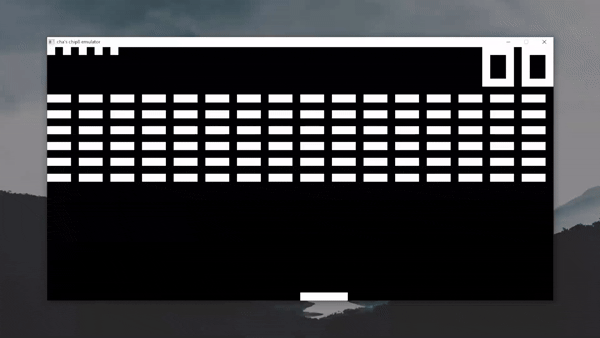
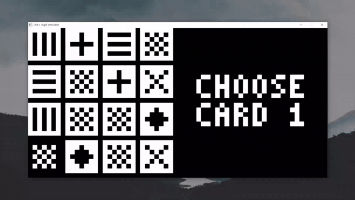
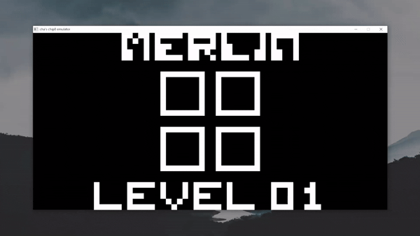

# CHIP-8 Emulator

A simple emulator for the CHIP-8.

## What's a CHIP-8?

> CHIP-8 is an interpreted programming language, developed by Joseph Weisbecker on his 1802 microprocessor. It was initially used on the COSMAC VIP and Telmac 1800, which were 8-bit microcomputers made in the mid-1970s.

> CHIP-8 was designed to use less memory than other programming languages like BASIC, while still being easier to program than machine code.[1] The language looks like machine code as it uses hexadecimal codes for instructions, but as an interpreter, like BASIC, it does not need to be assembled or linked before running.

From the [Wikipedia](https://en.wikipedia.org/wiki/CHIP-8).

<details>
 <summary><strong>Emulator, interpreter, or virtual machine? - Read more</strong></summary>
 
 There is some debate over whether a CHIP-8 implementation should be called an emulator, an interpreter, or a virtual machine. In reality, these terms describe different aspects of what we are building.
 
 In this project, I use the term emulator because the goal is to recreate the CHIP-8 environment on a modern operating system, allowing classic CHIP-8 programs and games to run as they originally would within their intended environment.
 
 At the same time, CHIP-8 is not a physical processor or a complete hardware system. It is a virtual computing environment with its own instruction set, memory model, and display. Our implementation executes CHIP-8 instructions in software, which makes it an interpreter, while the environment in which those instructions run can be described as a virtual machine.
 
  These terms are not mutually exclusive. I call this project a CHIP-8 emulator to emphasize its purpose: bringing CHIP-8 software to modern systems. Under the hood, it achieves this by interpreting instructions and recreating the CHIP-8 virtual machine.
 
</details>

## Requirements and dependencies

I'm building this with MSYS2 UCRT64 toolchain on Windows, using the g++ compiler and mingw32-make. SDL3 is used to render graphics on screen, and is installed with the MSYS2 pacman package manager:

```
pacman -S mingw-w64-ucrt-x86_64-sdl3
```

## Demo




## ROMs
ROMs are chosen from https://archive.org/download/Chip-8RomsThatAreInThePublicDomain, putting here for quick play tests.

## Useful references
Useful links I found throughout learning and writing this emulator.

- **CHIP-8 guide**: https://multigesture.net/articles/how-to-write-an-emulator-chip-8-interpreter/
- **Another CHIP-8 guide**: https://austinmorlan.com/posts/chip8_emulator/
- **Test ROM**: https://github.com/corax89/chip8-test-rom
- **Specs lookup**: https://en.wikipedia.org/wiki/CHIP-8#Virtual_machine_description
- **Technical reference**: http://devernay.free.fr/hacks/chip8/C8TECH10.HTM
- **SDL3 tutorial**: https://lazyfoo.net/tutorials/SDL3/index.php

